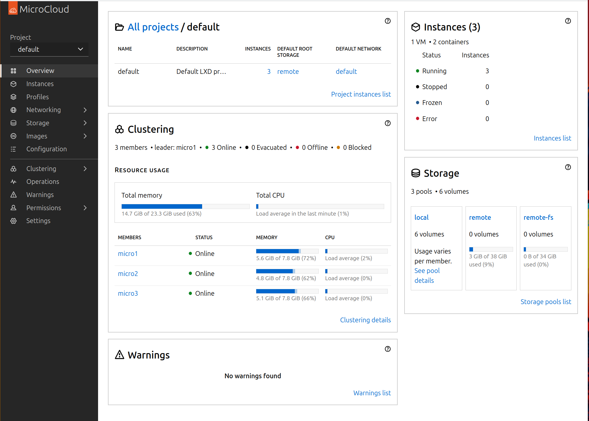
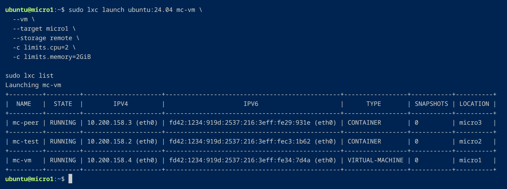
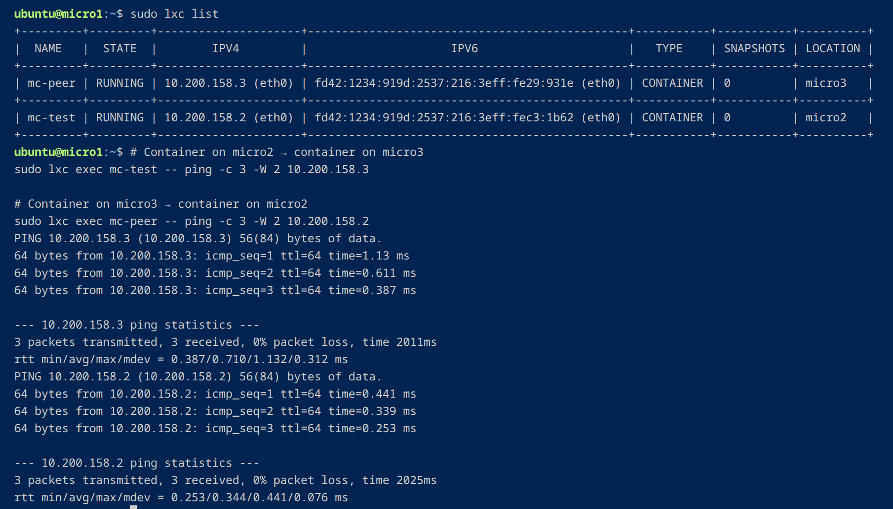

# Canonical MicroCloud — Three-Node Ubuntu Lab

I built a three-node Canonical MicroCloud cluster from scratch on my Debian workstation. I wanted to see the whole stack come together: LXD for workloads, MicroCeph for storage, MicroOVN for networking, and the automation needed to make the nodes consistent.

I provisioned three Ubuntu Server VMs with KVM/libvirt and cloud-init, brought up the cluster, and deployed two containers and a nested Ubuntu VM across the nodes. Then I tested the pieces that make it useful: storage, cross-node traffic, outbound connectivity, and management.

*The MicroCloud dashboard during my November 7, 2026, validation session.*

## What I got working

- **A three-node cluster:** MicroCloud, LXD, and MicroOVN reported all three members online. MicroCeph reported `HEALTH_OK`, with all three OSDs up and in.
- **Real workloads:** I launched two Ubuntu containers on separate nodes and a nested Ubuntu virtual machine on the third. I verified Ceph-backed root storage for the first container and the VM.
- **Networking:** I tested traffic between containers on different nodes, plus outbound IPv4 connectivity and DNS from the workloads.
- **Automation:** I used cloud-init and shell scripts to provision the Ubuntu guests and Ansible to verify networking, host readiness, and matching MicroCloud software versions.
- **Ubuntu management:** I connected all three nodes to Ubuntu Pro and Landscape, then checked their enrollment and client status.
- **Security:** I used YubiKey-backed SSH, tracked down an unexpected guest-to-LAN route, and used a targeted nftables rule to isolate the lab while keeping internet access and DNS working.

## A few results

### Containers and a VM on three nodes

*One Ubuntu VM on micro1, with containers on micro2 and micro3.*

### Networking across nodes

*Both directions of the cross-node ping test returned three replies and no packet loss.*

I collected the [cluster-health checks](screenshots/README.md#ceph-and-lxd-health), [network and storage configuration](screenshots/README.md#microovn-networks-and-storage-pools), and [Ansible results](screenshots/README.md#ansible-preflight) in the screenshot gallery, with context for each test.

## The setup

| Part | Tools |
|---|---|
| Virtualization | Debian, KVM/QEMU, libvirt, Ubuntu Server 26.04 LTS |
| Cluster, workloads, and storage | MicroCloud, LXD, MicroCeph |
| Networking | MicroOVN, libvirt networks, nftables |
| Provisioning and administration | Cloud-init, Bash, Ansible, YubiKey-backed SSH |
| Management | Ubuntu Pro, Landscape |

All three nodes are virtual machines on one workstation. That let me explore multi-node clustering and distributed services without needing three physical servers.

## Behind the build

For a guided walkthrough, start with the **architecture**, move to the **validation results**, then read about the **operations and troubleshooting**. Each guide links to the next one and back to this overview. The screenshot gallery keeps the evidence together on a browsable page.

- [Architecture and deployment approach](docs/architecture.md)
- [What I tested and the results](docs/validation.md)
- [Operations, security and Ubuntu management](docs/operations.md)
- [Ansible automation](ansible/README.md) and [VM provisioning scripts](scripts/)
- [Sample deployment readiness assessment](docs/03-deployment-readiness-assessment.md)
- [Screenshot gallery — all 11 images in context](screenshots/README.md)

You can also use the [engineering guide](docs/README.md) as a navigation hub.
