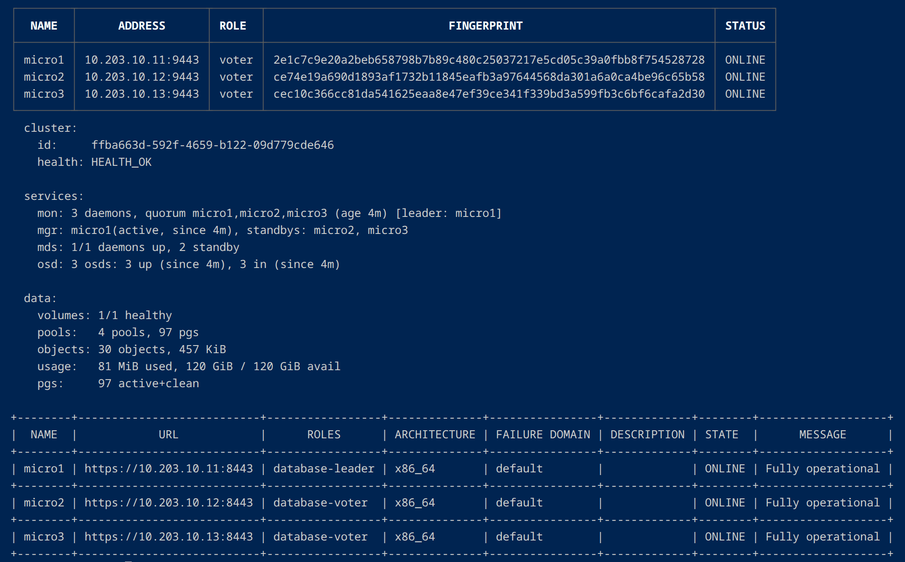
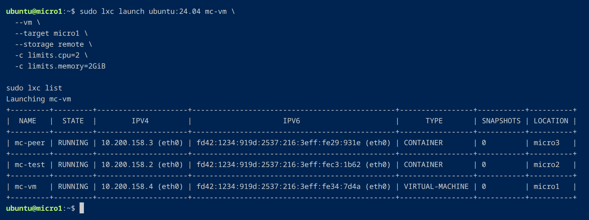
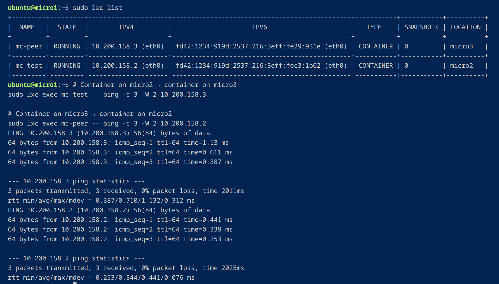
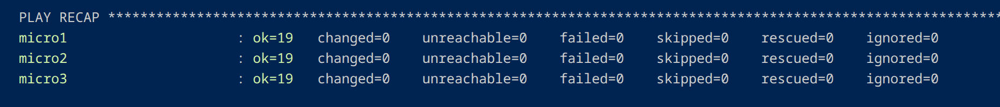
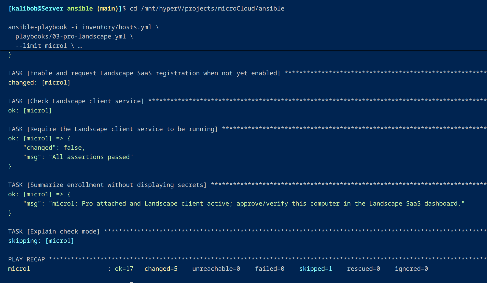

# Validation — What Worked

[← Architecture](architecture.md) · [Engineering guide](README.md) · [Screenshot gallery](../screenshots/README.md)

I treated each stage like a small experiment: bring it up, inspect the result, then test it with real traffic or a workload. Here's what passed during my **November 7, 2026** validation session.

| Area | What I checked | Result |
|---|---|---|
| Three-member cluster | MicroCloud, LXD and MicroOVN cluster membership | All three virtual members online |
| Ceph | Monitor quorum, OSD state, overall health | `HEALTH_OK`, 3/3 OSDs up and in |
| Storage | LXD local, Ceph and CephFS pools; the root disk of the first container and the nested VM | Pools created; verified Ceph-backed root disks |
| Workloads | LXD instance list and VM guest boot | Two running containers on micro2/micro3; running Ubuntu VM on micro1 |
| Cross-node networking | Container-to-container ping, both directions | Three of three replies, 0% loss on each test |
| Egress and DNS | Gateway and public IPv4 ping; `getent ahostsv4 ubuntu.com` | Successful reachability and name resolution |
| Ansible | Connection, sudo, initial pre-cluster preflight and revision checks | 3/3 nodes accepted with no failures; preflight `ok=19 changed=0` per node |
| Ubuntu management | `systemctl is-active landscape-client`, `pro status` and Landscape SaaS listing | All three Landscape clients active; Pro attached, Landscape enabled, instances online |
| Network isolation | Guest router reachability before/after the host nftables control; outbound IPv4 and DNS regression | Test router path blocked (0/3 ICMP) while outbound IPv4 and DNS still worked |

## Screenshots: the tests in action

### Cluster health

### Actual workloads

### Cross-node networking

### Ansible verification

### Ubuntu Pro and Landscape onboarding

The Ansible enrollment run on `micro1` completed with `ok=17 changed=5 failed=0`, including Ubuntu Pro attachment and Landscape client activation. The subsequent three-node client and SaaS checks are summarized in the table above.

## Key commands

The core live checks used tools such as `microcloud cluster list`, `microceph.ceph status`, `microovn cluster list`, `lxc cluster list`, `lxc storage list`, `lxc list`, guest `ping` and DNS lookups. See the [screenshot gallery](../screenshots/README.md) for the rest of the recorded outputs, organized by stage.

The workload and cluster VMs were shut down after the test session. The screenshots capture the running system while I was validating it.

[← Architecture](architecture.md) · [Next: Operations and security →](operations.md) · [Project overview](../README.md)
