# MicroCloud Screenshot Gallery

[← Project overview](../README.md) · [Engineering guide](../docs/README.md) · [Validation results](../docs/validation.md)

These are the 11 screenshots I kept from my November 7, 2026 lab session. They're displayed here with the test results, so you can browse the evidence without opening separate image files.

**Jump to:** [Cluster build](#cluster-build) · [Storage and networking](#storage-and-networking) · [Workloads and connectivity](#workloads-and-connectivity) · [Automation and Ubuntu management](#automation-and-ubuntu-management)

## Cluster build

### Initial MicroCloud formation

MicroCloud, MicroCeph, MicroOVN and LXD initialize, then `micro2` and `micro3` join the cluster.

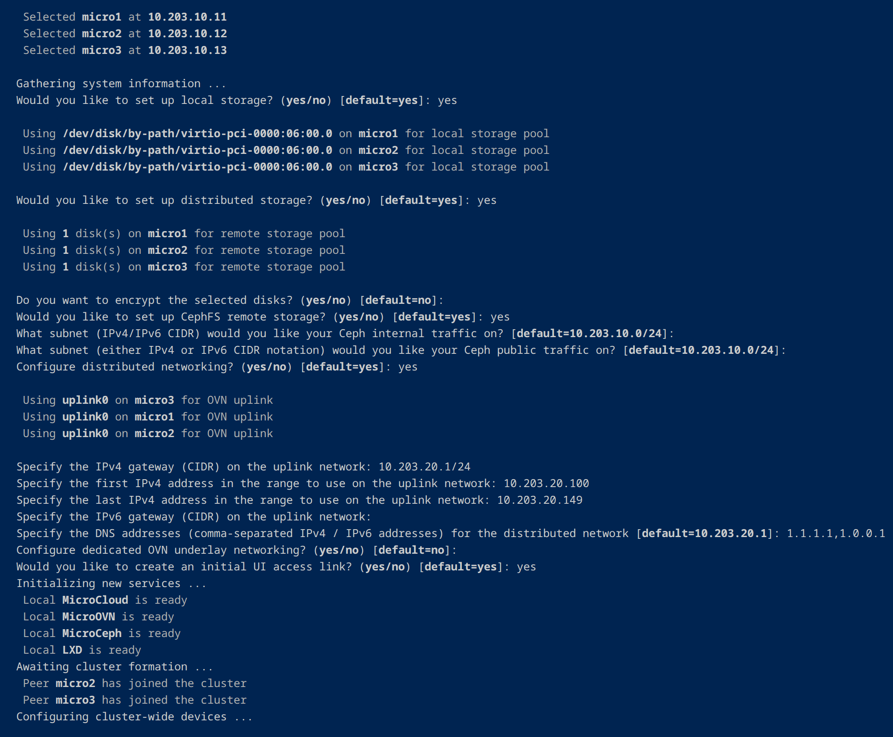

### Matching snap revisions

All three hosts passed the component revision checks for MicroCloud, LXD, MicroCeph and MicroOVN.

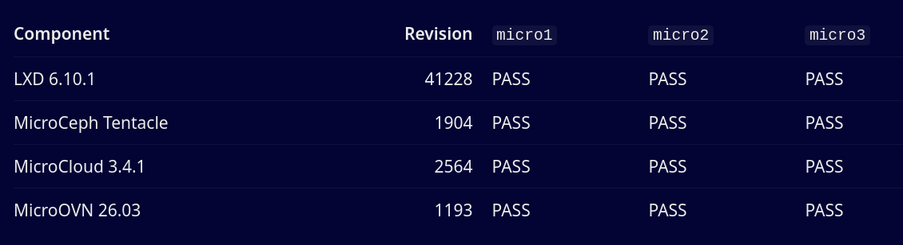

### Cluster members

The LXD dashboard shows all three virtual nodes online and fully operational.

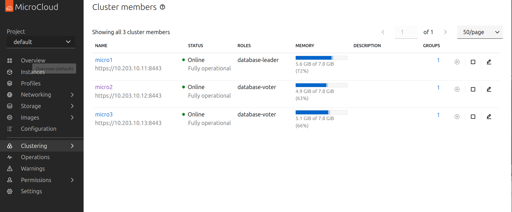

[Back to gallery sections](#microcloud-screenshot-gallery)

## Storage and networking

### Ceph and LXD health

Ceph reports `HEALTH_OK` with three OSDs up and in, alongside the MicroCloud and LXD membership checks.

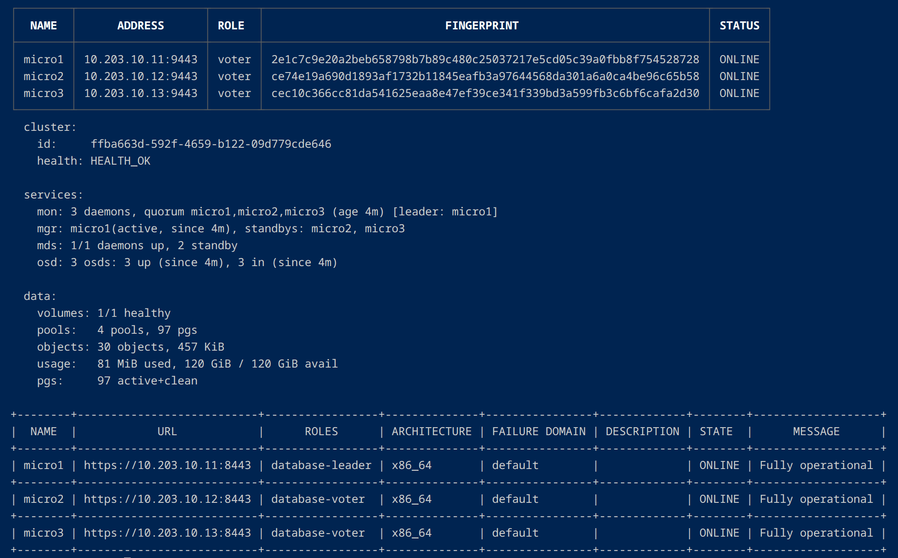

### MicroOVN networks and storage pools

Three MicroOVN voters are online, with the `local`, `remote` and `remote-fs` storage pools and the workload network.

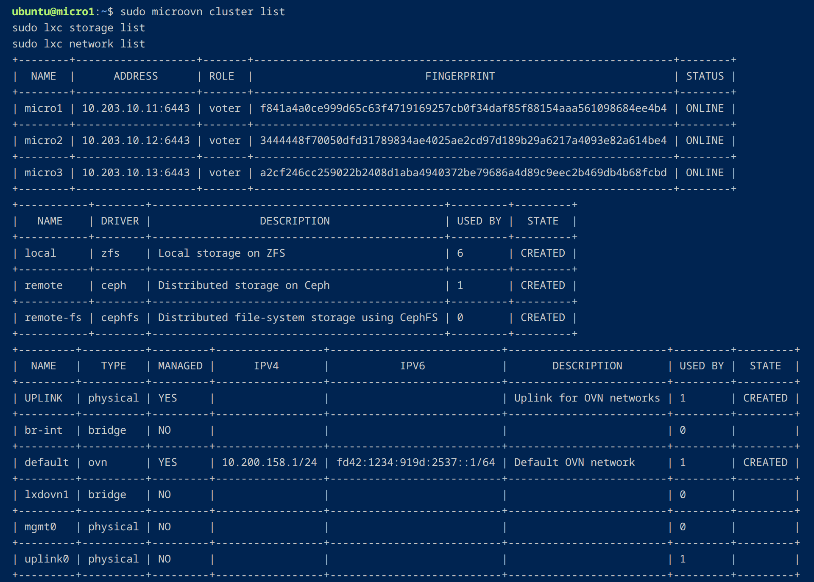

[Back to gallery sections](#microcloud-screenshot-gallery)

## Workloads and connectivity

### Running cluster dashboard

The web dashboard summarizes the three online cluster nodes, two containers, one VM and storage pools.

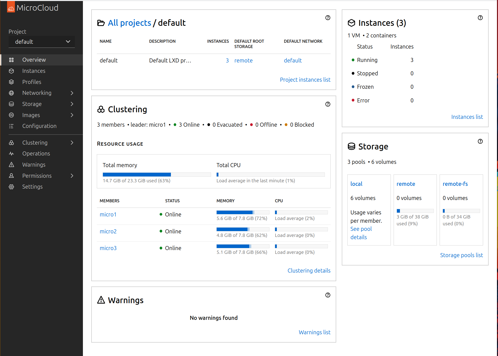

### Workload placement

Two Ubuntu containers and a nested Ubuntu VM run on different nodes, with the VM launched on the Ceph-backed `remote` pool.

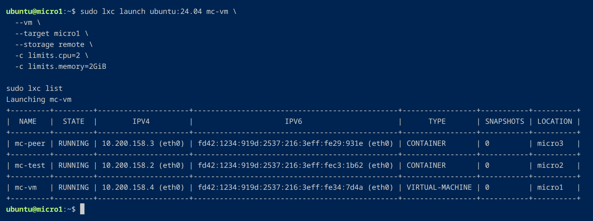

### Cross-node traffic

Containers on `micro2` and `micro3` exchanged ICMP traffic in both directions with zero packet loss.

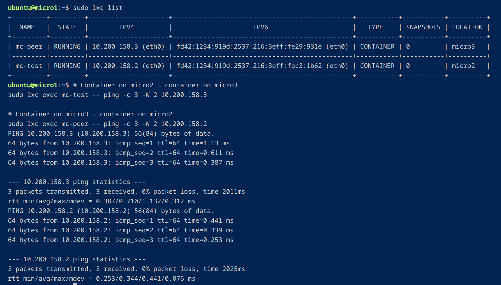

### IPv4 egress and DNS

The test container reached its gateway, public IPv4 addresses and resolved `ubuntu.com`.

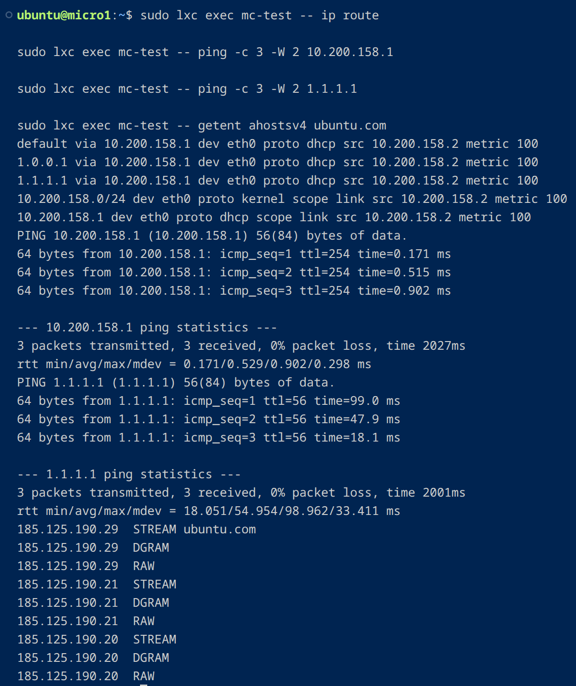

[Back to gallery sections](#microcloud-screenshot-gallery)

## Automation and Ubuntu management

### Ansible preflight

Pre-cluster acceptance on all three hosts finished with `ok=19 changed=0 unreachable=0 failed=0`.

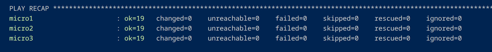

### Ubuntu Pro and Landscape onboarding

The Ansible enrollment run on `micro1` attached Ubuntu Pro, enabled Landscape and confirmed that the Landscape client was active. The run finished with `ok=17 changed=5 unreachable=0 failed=0`. Separate follow-up checks confirmed active Landscape clients on all three nodes.

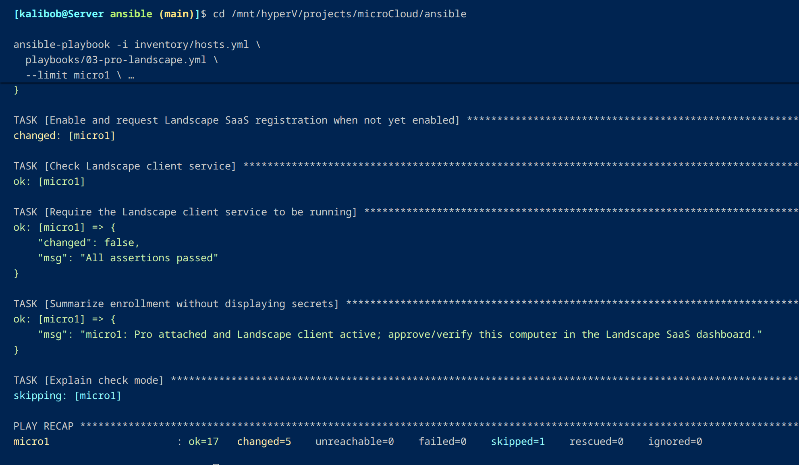

[← Back to validation results](../docs/validation.md) · [Engineering guide](../docs/README.md) · [Project overview](../README.md)
